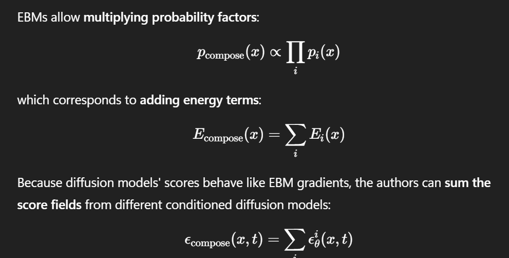

# Compositional Visual Generation with Composable Diffusion Models

**Authors:** Nan Liu, Shuang Li, Yilun Du, Antonio Torralba, Joshua B. Tenenbaum  
**Topic:** Composing diffusion models via EBM interpretation for compositional image generation  
**Related:** [[reduce-reuse-recycle]], [[spatial-reasoning-denoising]]

---

## Summary

Shows that diffusion models can be composed by interpreting them as **energy-based models (EBMs)**. Proposes two compositional operators — **Conjunction (AND)** and **Negation (NOT)** — that work at inference time without additional training.

## The Problem

Current systems fail at complex multi-concept descriptions — they are not fully compositional and generate incorrect images when given more detailed prompts.

## EBM Connection — Key Equation

## EBM Connection

- Diffusion models and EBMs are connected through score matching
- This connection is key for composition: composing EBMs is mathematically well-defined (product/quotient of distributions)
- Enables composing independently-trained diffusion models at inference time

## Compositional Operators

**Conjunction (AND):**
- Probabilistic assumption: concepts c_j are **independent** of each other
- Composed score = sum of individual scores
- Generates images satisfying ALL specified concepts

**Negation (NOT):**
- Divide wanted concepts by unwanted ones
- Probability of unwanted concepts decreases → main equation increases
- Generates images with desired attributes while avoiding unwanted ones

## Evaluation

- Binary classifiers trained per domain to check concept satisfaction:
  - CLEVR classifier: **99.05%** accuracy
  - Relational CLEVR: **99.80%** accuracy
  - FFHQ attribute classifiers: **95–99%** accuracy (smiling, glasses, gender)
- For each test: generate **5,000 images**, run classifier per concept, count fraction satisfying ALL concepts

## Domains

- CLEVR (object positions/attributes)
- Relational CLEVR (spatial relations between objects)
- FFHQ (face attributes: smiling, glasses, gender)

## Limitations

Not explicitly documented in notes.
