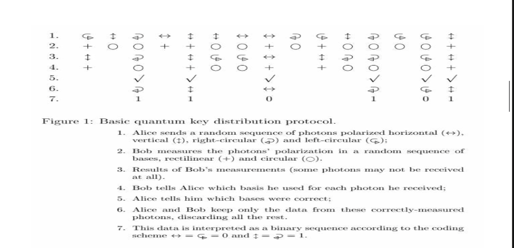

# Quantum Cryptography

**Authors:** J. Aditya, P. Shankar Rao  
**Topic:** Overview of quantum cryptography and Quantum Key Distribution (QKD)  
**Related:** [[post-quantum-cryptography]], [[cybersecurity-notes]], [[smartcards]]

---

## Summary

Overview of quantum cryptography, covering its theoretical foundations and practical deployment through SECOQC and the DARPA Quantum Network.

## Classical Cryptography Weakness

- RSA and Diffie-Hellman are NOT based on concrete mathematical proofs
- Security relies on the assumed difficulty of factoring large integers
- Uncertainty: a theorem may be developed (or may already exist) that can factor large primes in polynomial time

## Quantum Foundations

**Heisenberg Uncertainty Principle:**
- It is not possible to measure the quantum state of any system without disturbing that system
- Eavesdropping on a quantum channel is **detectable**

**Photon Polarization Principle:**
- Describes how light photons can be oriented/polarized in specific directions
- Bennett and Brassard: an encryption key can be created depending on how many photons reach a recipient and how they are received (BB84 protocol basis)

## QKD Protocol Diagram

## Key Challenges of QKD

1. **Key distribution problem:** Repositioned secret keys require some means of distributing keys *before* QKD begins
2. **DoS vulnerability:** An adversary can force a QKD system to exhaust its stockpile of key material
3. **Single point-of-failure:** QKD has been employed along single point-to-point links — if the link is disrupted (eavesdropping or fiber cut), all keying material flow ceases

## Practical Deployment

- **SECOQC** (Secure Communication based on Quantum Cryptography): research network demonstrating QKD in practice
- **DARPA Quantum Network:** Allows VPN connections to be made using quantum cryptography

## See Also

- [[post-quantum-cryptography]] — post-quantum algorithms for classical computers
