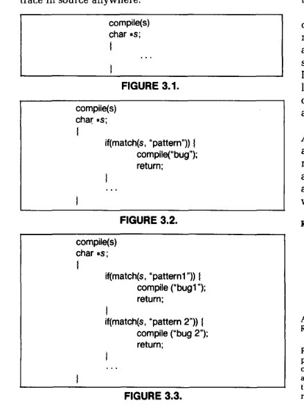

# Reflections on Trusting Trust

**Author:** Ken Thompson (ACM Turing Award Lecture, 1984)  
**Topic:** Compiler Trojan horse that self-replicates through the build toolchain  
**Related:** [[cybersecurity-notes]], [[devsecops]], [[heckler]]

---

> "To what extent should one trust a statement that a program is free of Trojan horses? Perhaps it is more important to trust the people who wrote the software."

## Summary

Classic paper demonstrating that **you cannot trust code you did not totally create yourself**. Shows how a modified C compiler can plant a self-replicating Trojan horse that is invisible in source code but persists in compiled binaries — a foundational supply-chain security concept.

## Self-Replicating Trojan Diagram

## The Core Idea

1. Modify the C compiler to deliberately miscompile code whenever a specific pattern is matched
2. The modification is **not in the source code** — it's in the compiled compiler binary
3. Even if you recompile the compiler from "clean" source, the compiled output contains the Trojan because the Trojan compiler was used to compile it
4. This is self-referencing: a learning/self-replicating definition baked into the binary

> "Figure 3.2 shows a simple modification to the compiler that will deliberately miscompile source whenever a particular pattern is matched. If this were not deliberate, it would be called a compiler 'bug.' Since it is deliberate, it should be called a 'Trojan horse.'"

## Key Insight

The attack creates a **self-replicating Trojan horse** in the official C compiler binary:
- Looks completely clean in source code
- Invisible to code review
- Persists through every recompilation

## Moral

> "You can't trust code that you did not totally create yourself."
> "As the level of program gets lower, these bugs will be harder and harder to detect. A well-installed microcode bug will be almost impossible to detect."

## Relevance Today

- Foundation of supply-chain security concerns
- Relevant to [[devsecops]] — build provenance, SLSA framework, reproducible builds
- Motivates trusting the *people* who build compilers and toolchains, not just auditing the source
