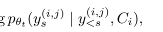

# Self-Adapting Language Models (SEAL)

**Authors:** Adam Zweiger, Jyothish Pari, Han Guo, Ekin Akyürek, Yoon Kim, Pulkit Agrawal  
**Topic:** RL-trained policy that generates self-edits for continued LLM learning  
**Related:** [[test-time-training]], [[combining-induction-transduction]], [[chain-of-thought-prompting]]

---

## Summary

SEAL enables LLMs to **self-adapt** by training an RL policy that generates **natural-language "self-edits"** — directives that specify synthetic training data (and optionally hyperparameter choices). The model improves itself beyond the current context, unlike ICL or standard TTT.

## What Are Self-Edits?

Natural-language directives that specify:
- Synthetic training data to generate
- Optionally: optimization choices (learning rate, epochs)
- **Domain-specific:** for knowledge incorporation → parameter changes; for ARC → augmentation specifications

## SEAL vs. ICL vs. TTT

| | ICL | TTT | SEAL |
|---|---|---|---|
| Parameter updates | No | Yes (temporary) | Yes (lasting) |
| Duration | In-context only | Inference time only | Persists beyond context |
| Policy | None | None | RL-trained policy |

## Autoregressive Distribution

## RL Framework

- **State:** (context C, parameters θ)
- **Actions:** the self-edit text
- **Rewards:** downstream accuracy after inner-loop update
- **Challenge:** reward depends on θ in a non-differentiable way

## Training: ReSTEM (Rejection Sampling + SFT)

To handle non-differentiable rewards:
1. Sample many self-edits
2. Keep only those that **improve downstream performance** (binary reward)
3. Perform supervised fine-tuning on these "good" edits

## Key Results

- **Figure 4:** Two iterations of SEAL suffice to surpass GPT-4.1 data quality; diminishing returns after that
- **Figure 6:** Information retention across iterations

## Scaling Limitations

1. **Compute overhead:** Each candidate self-edit requires inner-loop fine-tuning + evaluation (~30–45s/edit; full rounds take hours)
2. **Label coupling:** Requires explicit evaluation τ per context (QA pairs, held-out queries)
3. **Catastrophic forgetting** over long edit sequences
